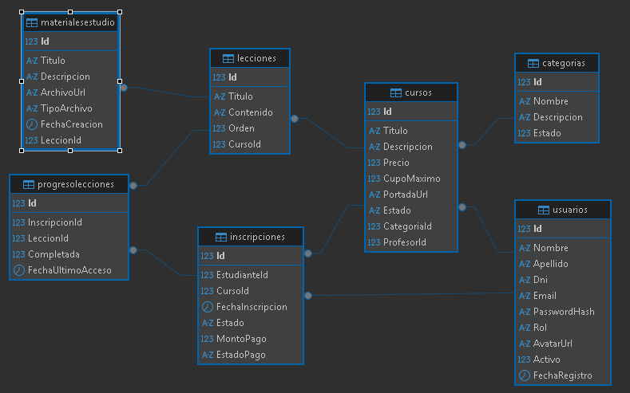
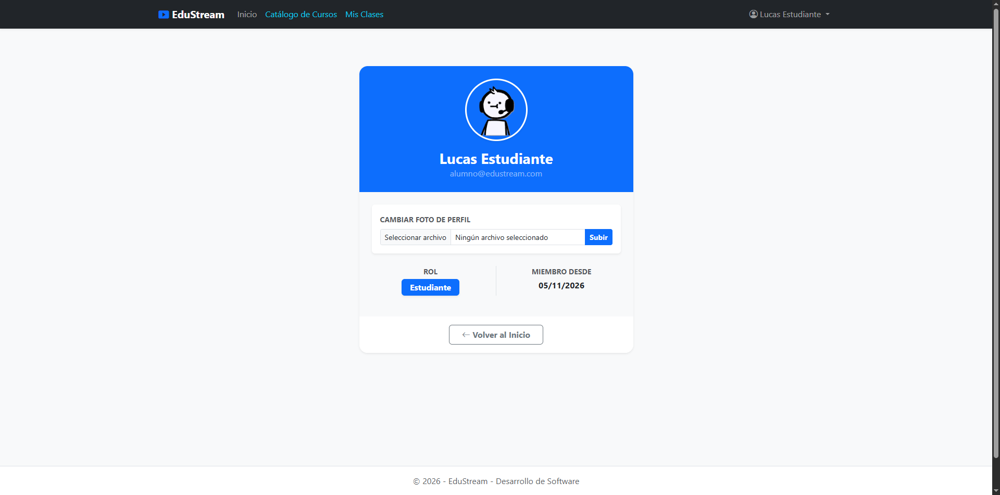
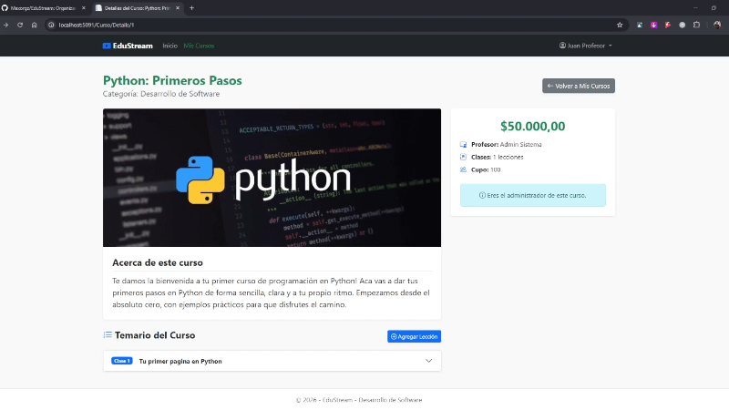

# 🎓 EduStream - Plataforma Educativa Integral

Organizar cursos virtuales sin una plataforma centralizada es un verdadero problema para instituciones y profesores independientes. La falta de un sistema integrado genera desorganización administrativa, dificulta el seguimiento del avance de los alumnos y complica tanto la distribución de materiales como la actualización del catálogo de clases.

Sistema web integral desarrollado en **ASP.NET Core MVC** diseñado para la gestión de cursos, administración de alumnos, carga de material de estudio y seguimiento del progreso educativo.

---

## 📌 Descripción del Proyecto

El proyecto resuelve la problemática de la gestión académica centralizando:
- Administración del catálogo de cursos, categorías, lecciones y materiales de estudio.
- Control de usuarios y roles (Administrador, Profesor, Estudiante) con autenticación basada en Cookies y JWT.
- Sistema de inscripciones y seguimiento del progreso en tiempo real para los estudiantes.
- Interfaces dinámicas y consumo de una Web API REST autenticada con JWT para integraciones externas.

---

## 👥 Credenciales de Prueba

El sistema detectará la base de datos y creará automáticamente los usuarios de prueba mediante `DbInitializer.cs` al levantar la aplicación por primera vez.

| Rol | Email / Usuario | Contraseña | Acceso Principal |
|---|---|---|---|
| **Administrador** | `admin@edustream.com` | `Admin123!` | Gestión total (Cursos, Usuarios, ABM) |
| **Profesor** | `profe@edustream.com` | `Profe123!` | Crear Cursos y Lecciones |
| **Alumno** | `alumno@edustream.com` | `Alumno123!` | Catálogo de cursos y Mis Inscripciones |

---

## 🛠️ Estructura del Proyecto

- **/BaseData**: Script de estructura de la base de datos MySQL (`EduStreamDB.sql`).
- **/Controllers**: Controladores MVC para las vistas (`CursoController`, `InscripcionController`, etc.) y endpoints REST (`AuthApiController`, `CursosApiController`).
- **/Data**: Contexto de datos (`EduStreamDbContext.cs`) y clase de inicialización automática de datos (`DbInitializer.cs`).
- **/Models**: Entidades principales del sistema (Curso, Usuario, Inscripcion, Leccion, MaterialEstudio).
- **/repositories**: Abstracción de acceso a datos aplicando el patrón Repositorio (Interfaces e Implementaciones).
- **/Views**: Vistas Razor renderizadas en el servidor, organizadas por entidad.
- **/wwwroot**: Archivos estáticos, estilos, scripts y directorio de subida para avatares y archivos de materiales.

---

## 🚀 Instrucciones de Ejecución Local

1. **Clonar el repositorio:**
   ```bash
   git clone https://github.com/Danirodriguez45B/EduStream.git
   ```

2. **Configurar la cadena de conexión:**
   Asegúrate de ajustar tu contraseña de MySQL en `appsettings.json`:
   ```json
   "ConnectionStrings": {
     "DefaultConnection": "server=127.0.0.1;port=3306;database=EduStreamDB;user=root;password=TU_PASSWORD_LOCAL;AllowPublicKeyRetrieval=true;"
   }
   ```

3. **Crear la Base de Datos y Estructura:**
   Ejecuta el script SQL desde tu gestor preferido (DBeaver, MySQL Workbench) o mediante el siguiente comando en la terminal:
   ```bash
   mysql -u root -p < BaseData/EduStreamDB.sql
   ```
   *(Esto creará la base de datos `EduStreamDB` con sus 7 tablas vacías).*

4. **Ejecutar la Aplicación y Seeding Automático:**
   Abre una terminal en la raíz del proyecto y ejecuta:
   ```bash
   dotnet restore
   dotnet run --launch-profile https
   ```
   > 💡 **Carga Automática de Usuarios:** Al iniciar la aplicación, `DbInitializer.cs` comprobará que la tabla `Usuarios` está vacía y creará automáticamente los 3 usuarios de prueba con sus contraseñas encriptadas mediante BCrypt.

---

## 📋 Matriz de Evidencias de Requerimientos Mínimos

| Requerimiento Mínimo | Estado | Enlace al Código / Controladores | Evidencia (Captura / GIF / Video) |
| :--- | :--- | :--- | :--- |
| **1. 4 Tablas y Relación 1:N** | ✅ Cumplido | [EduStreamDB.sql](./BaseData/EduStreamDB.sql) |  |/docs/
| **2. Login, Roles y Avatar** | ✅ Cumplido | [UsuarioController.cs](./Controllers/UsuarioController.cs) |  |
| **3. Manejo de Archivos (Extra)** | ✅ Cumplido | [MaterialEstudioController.cs](./Controllers/MaterialEstudioController.cs) |  |
| **4. ABM en Vue.js + AJAX** | ✅ Cumplido | [CursosApiController.cs](./Controllers/CursosApiController.cs) |  |
| **5. Paginado por Servidor** | ✅ Cumplido | [RepositorioCurso.cs](./repositories/RepositorioCurso.cs) |  |
| **6. Selección Asíncrona (AJAX)** | ✅ Cumplido | [InscripcionController.cs](./Controllers/InscripcionController.cs) |  |
| **7. Web API + JWT** | ✅ Cumplido | [AuthApiController.cs](./Controllers/AuthApiController.cs) | Con token:  |